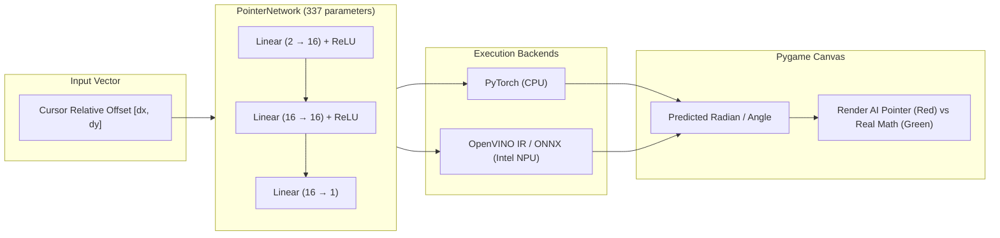

# Simple ML Pointer Game

[](https://python.org)
[](https://pytorch.org)
[](https://openvino.ai)
[](https://onnx.ai)
[](https://pyga.me)
[](https://www.intel.com)
[](LICENSE)

An interactive Pygame machine learning experiment where a tiny custom neural network learns trigonometry from scratch—predicting the exact angle to the mouse cursor, accelerated on either the CPU via PyTorch or the **Intel NPU silicon via OpenVINO**.

> *Yes, it's partially LLM-assisted code, but this is a hands-on demo/self-learning project exploring neural nets, ONNX computation graphs, and NPU acceleration. Most of the logic, visuals, and architecture were built by me :)*

---

## Architecture & Dataflow

The model is a lightweight **337-parameter** multi-layer perceptron (MLP) trained to approximate NumPy's `np.arctan2(dy, dx)` (four-quadrant inverse tangent) purely through linear layers and non-linear ReLU activations.



### Model Details
* **Inputs:** 2 (`dx`, `dy` distance from canvas center)
* **Hidden Layers:** 2 layers with 16 neurons each
* **Output:** 1 scalar (predicted angle in radians)
* **Training Data:** Synthetically generated `(x, y)` coordinate pairs mapped to ground-truth angles.

### Model Naming Convention
Pre-trained checkpoints in `models/` follow the pattern:
```
XXpassYYY.pth
```
* **`XX`**: Number of training epochs (e.g., `250`).
* **`YYY`**: Size of the training dataset (e.g., `1m` = 1,000,000 samples).

---

## Project Structure

```text
.
├── dataset/
│   ├── generateData.py      # Use to generate synthetic data
│   └── pointer_data.csv     # Generated training data
├── exports/
│   ├── xxx.onnx             # Exported model/s
│   └── exportONNX.py        # Exporter from PyTorch .pth to .onnx
├── others/
│   ├── analyzer.py          # Use to visualize model performance
│   └── cheatsheet.py        # BS i used to help me get started
├── runPygame.py             # Live inference using the CPU
├── runPygameNPU.py          # Live inference using the Intel NPU via OpenVINO
├── train.py                 # Neural network training loop, CPU only
├── requirements.txt         # Project dependencies
└── README.md                # This file
```

---

## Quick Start

### 1. Installation
Clone the repository and set up a virtual environment:

```bash
git clone https://github.com/your-username/man_pointer.git
cd man_pointer

python3 -m venv .venv
source .venv/bin/activate
pip install -r requirements.txt
```

### 2. Run the Game (CPU)
Runs standard PyTorch inference on your CPU:
```bash
python3 runPygame.py
```
* When prompted, enter the model name to test (e.g., `250pass1m`).
* Select mode: `nor` for manual mouse tracking, or `ran` for automated random sampling.

### 3. Run the Game (Intel NPU)
Offloads real-time inferences directly to the **Intel Lunar Lake / Meteor Lake NPU** using OpenVINO:
```bash
python3 runPygameNPU.py
```

### 4. Export Model to ONNX
Export your trained `.pth` PyTorch weights into a universal, compact `.onnx` model:
```bash
python3 exports/exportONNX.py
```

### 5. Train Your Own Model
Generate new data and train the brain from scratch:
```bash
python3 dataset/generateData.py
python3 train.py
```

---

## In-Game Controls & Visuals

* **Red Center Circle:** The origin point `(0, 0)`.
* **Green Box:** The target position (your mouse cursor or random target).
* **Red Line:** The **AI's predicted angle**.
* **Green Line:** The **ground-truth mathematical angle** (`arctan2`).
* **HUD Display:** Real-time feedback showing current AI angle, true angle, and absolute error in degrees.
